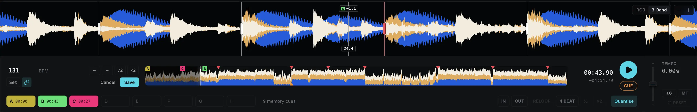
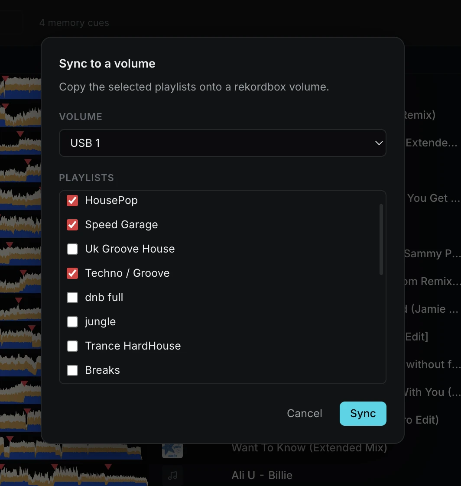
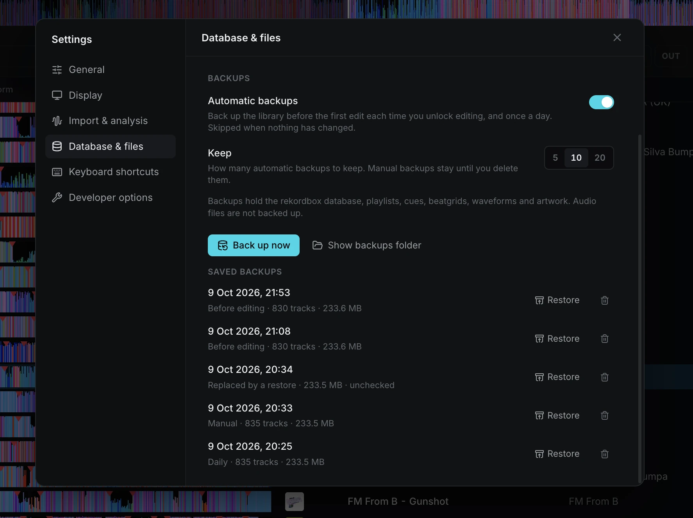

<p align="center">
  
</p>

# Export Studio - The Export Mode You Actually Want

Export Studio is a library browser for rekordbox. Browse your collection, preview tracks, edit playlists and tags, analyse new files, and copy playlists to a USB stick. Your library stays in rekordbox's own database.

## Download

Export Studio is currently in alpha, the app is not considered stable and anything is subject to change.

Builds can be downloaded from the [releases page](https://github.com/claw1200/export-studio/releases).

## Why Export Studio?

Export Studio is a library browser for rekordbox, with with a fundamentally different vision to other alternate tools.

Export Studio looks to completely overhaul the available feature set of a library manager, not just to strip down rekordbox to its essentials. I believe that rekordbox does not just need optimization, but a redesign from the ground up, hence why I have chosen not to copy the old interface and workflow.

## Roadmap and Vision

I would eventually like to add support for Serato and other DJ software libraries, so that DJs using these programs can also export a rekordbox USB for their DJ sets. However, I want to get full feature parity with rekordbox before I add support for other libraries.


## Key Features


| Feature                           | Export Studio | rekordbox |
| --------------------------------- | ------------ | --------- |
| Standard beatgrid editing         | 🟢           | ✅         |
| Track Analysis                    | 🟢           | ✅         |
| USB sync / export                 | 🟢           | ✅         |
| Lightweight and responsive UI     | 🟢           | ❌         |
| High-resolution waveforms         | 🟢           | ❌         |
| Backups                           | 🟢           | ❌         |
| Track compatibility checks        | 🟢           | ❌         |
| Track format conversion           | 🟢           | ❌         |
| Views (duplicates, unsorted, etc) | 🟢           | ❌         |
| Support Serato Library            | 🟡           | ❌         |
| Dynamic beatgrid editing          | 🟡           | ✅         |
| Track Streaming                   | ⚫️           | ✅         |

- 🟢 Comparable or better
- 🟡 Planned / Working on it
- 🔴 Can't
- ⚫️ Maybe


Export Studio's goal is not just to strip down Rekordbox, but improve on the feature set. Export Studio improves:

### UI

Collection, playlists, histories, tags, and devices in one responsive window.


### High-resolution waveforms

Export Studio adds custom high-resolution waveforms, drawn from the audio, at up to 16,000 samples a second. This lets you zoom in on the waveform in far greater detail than rekordbox's built-in waveforms, so you can be confident your beatgrid is accurate.

A quality slider changes the number of samples used to draw the waveform. Off uses the waveform rekordbox stored during analysis.


### Grid editing

Stop spending hours holding down the nudge button to get the beatgrid just right. Export Studio lets you grab the beatgrid and drag it to the position you want, then use nudge to fine-tune it.



### Analysis

Export Studio works out tempo, beatgrid, and key itself. A normal grid fits one tempo to the whole track. Dynamic follows tempo changes, for live recordings and tracks that speed up. Cues are kept.

Tested on vast rekordbox libraries, it almost always matches or improves on rekordbox's analysis for beatgrids, tempo, and key.


### USB sync

Playlists you pick are checked before they replace what is on the stick. Playlists, history, and tracks this app did not create are left in place.

Sync uses the library's cues and beat grids in place of USB edits. If the library
has no analysis for a track, usable analysis already on the device is retained.

DeviceLibrary and OneLibrary are both written to the device, so that compatibility is preserved across all players.



### Backups

Backups are run when you unlock editing, and once a day when something has changed. You can restore any backup from Settings, a backup is taken before you restore, so you can undo the restore if you made a mistake.

> [!NOTE]
> Audio files are not included in the backup.




### Editing

Improved track metadata editing. Title, artist, rating, and colour are editable from a single dialog or from the information panel on the left.

Select multiple tracks to edit their metadata in bulk.

You can also change your preferences to write the changes to the actual file as well as the database.


## Development

### Prerequisites

- Node.js and npm
- Rust stable and Cargo (`rustup toolchain install stable`)
- Xcode Command Line Tools on macOS (`xcode-select --install`)

### Setup

From the repository root:

```sh
git submodule update --init --recursive
cd app
npm install
npm run dev
```

The SDK submodule is private. GitHub Actions requires an `SDK_REPO_TOKEN` repository
secret with read access to `claw1200/es-rekordbox-sdk`.

`npm run dev` builds the Rust Node addon and USB exporter, copies them into `app/resources/native`, then starts Electron. To run just the Rust tests, use `npm run test:native` from `app`.

### Build Options

- `npm run build:native` builds release native binaries.
- `npm run build:native:debug` builds debug native binaries.
- `ES_NATIVE_TARGET=<rust-target> npm run build:native` cross-compiles for the specified Rust target. The target must be installed with `rustup target add <rust-target>`.

### Environment Variables

| Variable | Effect |
| --- | --- |
| `EXPORTSTUDIO_PROFILE_LIBRARY_OPEN=1` | Logs database snapshot stages, native service lock wait/operation time, and renderer startup stages. Use with `npm run dev`; native timings go to the terminal and renderer timings to DevTools. |
| `EXPORTSTUDIO_USB_EXPORT=/path/to/es-usb` | Uses a specific USB exporter binary instead of the app's default. |
| `EXPORTSTUDIO_FFMPEG=/path/to/ffmpeg` | Uses a specific FFmpeg binary for conversion. |
| `RB_LIBRARY_TEST=1` | SDK safety guard: refuses test writes to the installed Rekordbox library. |

```bash
EXPORTSTUDIO_PROFILE_LIBRARY_OPEN=1 npm run dev
```
