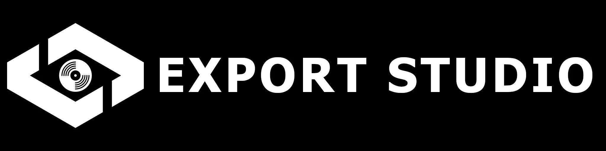
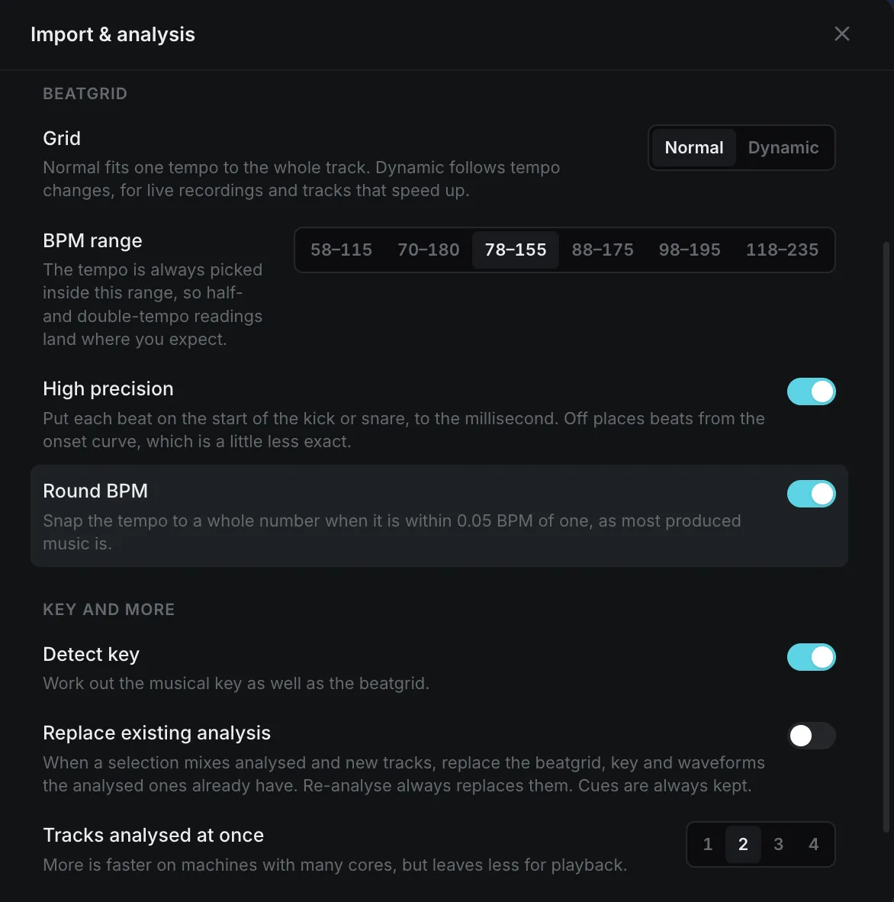

woukl

# ExportStudio - The Export Mode You Actually Want

ExportStudio is a library browser for rekordbox. Browse your collection, preview tracks, edit playlists and tags, analyse new files, and copy playlists to a USB stick. Your library stays in rekordbox's own database.

## Why ExportStudio?

ExportStudio is a library browser for rekordbox, with with a fundemtaly different vision to other alternate tools like [rbxport](https://github.com/chrisle/rbxport).

ExportStudio looks to compltly overhaul the avalible feature set of a library manager, not just to strip down Rekordbox to its essentials. I beleive that rekordbox does not just need optimization, but a redesign from the ground up, hence why I have chosen not to copy the old interface and workflow.

## Roadmap and Vision

I would eventally like to add support for Serato and other DJ software libraries, so that DJs using these programs can also export a rekordbox USB for their DJ sets. However, I want to get full feature parity with rekordbox before I add support for other libraries.

| Key | Status                  |
| --- | ----------------------- |
| 🟢  | Comparable or better    |
| 🟡  | Planned / Working on it |
| 🔴  | Can't                   |
| ⚫️  | Maybe                   |

| Feature                           | ExportStudio | rekordbox |
| --------------------------------- | ------------ | --------- |
| Lightweight and responsive UI     | 🟢           | ❌         |
| High-resolution waveforms         | 🟢           | ❌         |
| Backups                           | 🟢           | ❌         |
| Standard beatgrid editing         | 🟢           | ✅         |
| Dynamic beatgrid editing          | 🟡           | ✅         |
| Track Analysis                    | 🟢           | ✅         |
| USB sync                          | 🟢           | ✅         |
| Streaming                         | ⚫️           | ✅         |
| Playlist conversion               | 🟡           | ❌         |
| USB Hardware compatibility checks | 🟡           | ❌         |
| Phrase analysis                   | 🟡           | ✅         |
| Duel Player                       | 🟡           | ✅         |
| Support Serato Library            | 🟡           | ❌         |

## Key Features

ExportStudio's goal is not just to strip down Rekordbox, but improve on the feature set. ExportStudio improves:

### UI

Collection, playlists, histories, tags, and devices in one responsive window.

### High-resolution waveforms

ExportStudio adds custom high-resolution waveforms, drawn from the audio, at up to 16,000 samples a second. This lets you zoom in on the waveform in far greater detail than rekordbox's built-in waveforms, so you can be confident your beatgrid is accurate.

A quality slider changes the number of samples used to draw the waveform. Off uses the waveform rekordbox stored during analysis.

### Grid editing

Stop spending hours holding down the nudge button to get the beatgrid just right. ExportStudio lets you grab the beatgrid and drag it to the position you want, then use nudge to fine-tune it.

### Analysis

ExportStudio works out tempo, beatgrid, and key itself. A normal grid fits one tempo to the whole track. Dynamic follows tempo changes, for live recordings and tracks that speed up. Cues are kept.

Tested on vast rekordbox libraries, it almost always matches or improves on rekordbox's analysis for beatgrids, tempo, and key.

### USB sync

Playlists you pick are checked before they replace what is on the stick. Playlists, history, and tracks this app did not create are left in place.

DeviceLibrary and OneLibrary are both written to the device, so that compatibility is preserved across all players.

### Backups

Backups are run when you unlock editing, and once a day when something has changed. You can restore any backup from Settings, a backup is taken before you restore, so you can undo the restore if you made a mistake.

> [!NOTE]
> Audio files are not included in the backup.

### Editing

Improved track metadata editing. Title, artist, rating, and colour are editable from a single dialog or from the information panel on the left.

Select multiple tracks to edit their metadata in bulk.

You can also change your preferences to write the changes to the actual file as well as the database.

## Download

ExportStudio is currently in alpha, and can be downloaded from the [releases page](https://github.com/claw1200/export-studio/releases).