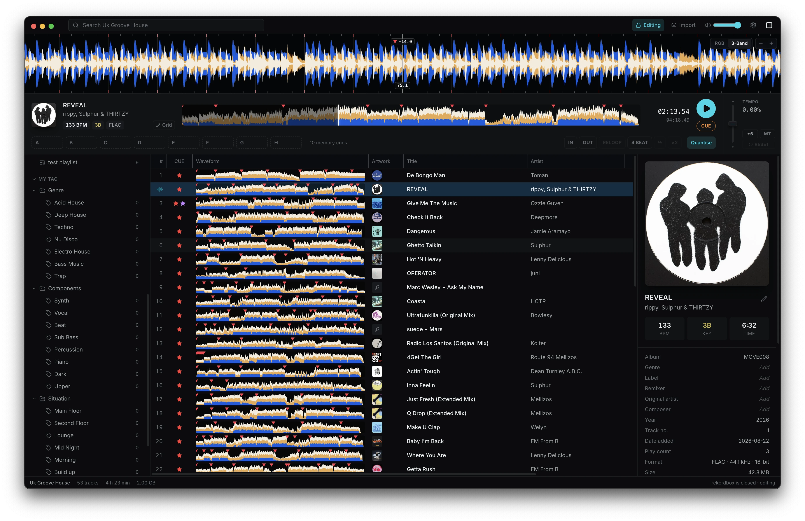
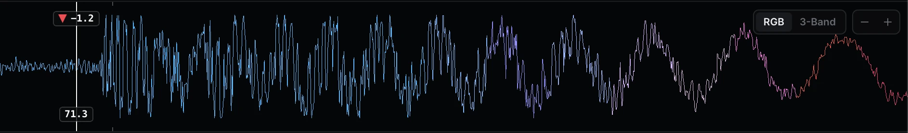
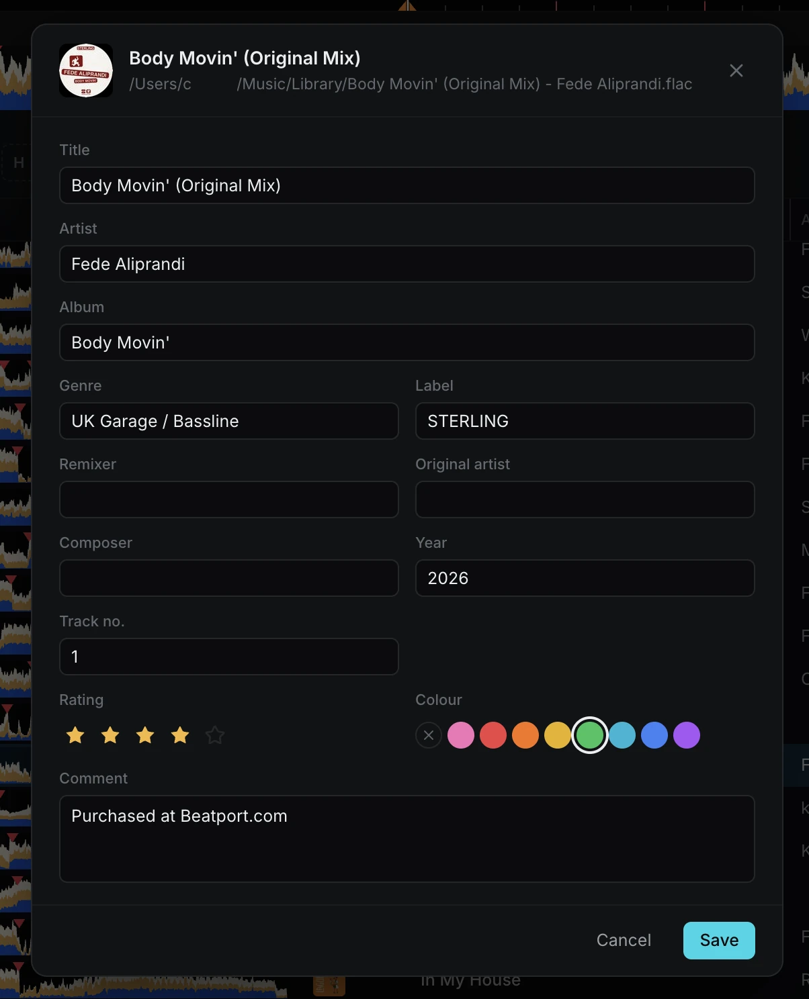

# ExportStudio - The Export Mode You Actually Want

ExportStudio is a library browser for rekordbox. Browse your collection, preview tracks, edit playlists and tags, analyse new files, and copy playlists to a USB stick. Your library stays in rekordbox's own database.

> [!NOTE]
> ExportStudio opens a rekordbox 6 or 7 library in read-only mode. Close rekordbox, then click the lock in the title bar to edit.

## Key Features

ExportStudio's goal is not just to strip down Rekordbox, but improve on the feature set. ExportStudio improves:

### UI

Collection, playlists, histories, tags, and devices in one responsive window.

### USB sync

Playlists you pick are checked before they replace what is on the stick. Playlists, history, and tracks this app did not create are left in place.

DeviceLibrary and OneLibrary are both written to the device, so that compatibility is preserved across all players.

### Backups

Backups are run when you unlock editing, and once a day when something has changed. You can restore any backup from Settings, a backup is taken before you restore, so you can undo the restore if you made a mistake.

### High-resolution waveforms

ExportStudio adds custom high-resolution waveforms, drawn from the audio, at up to 16,000 samples a second. This lets you zoom in on the waveform in far greater detail than rekordbox's built-in waveforms, so you can be confident your beatgrid is accurate.

A quality slider changes the number of samples used to draw the waveform. Off uses the waveform rekordbox stored during analysis.

### Editing

A snapshot until you unlock. Writes only while rekordbox is closed.

